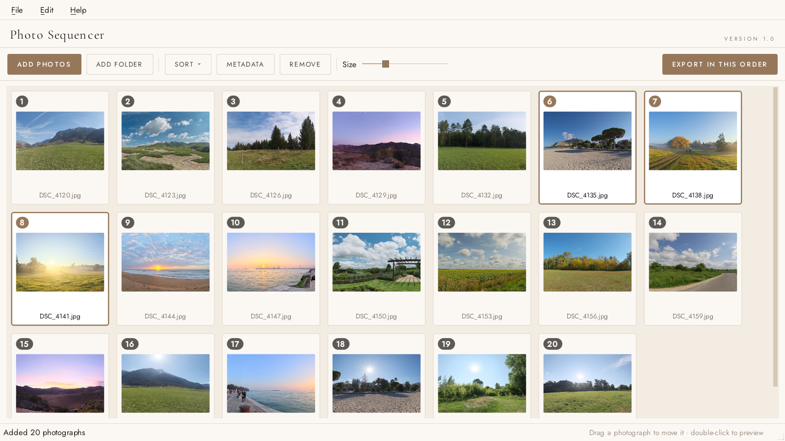
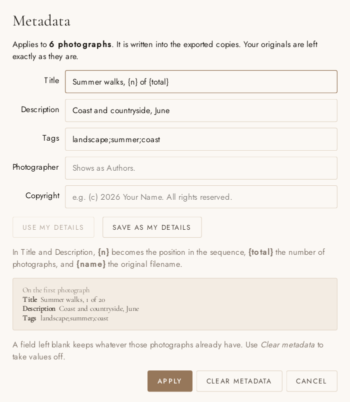
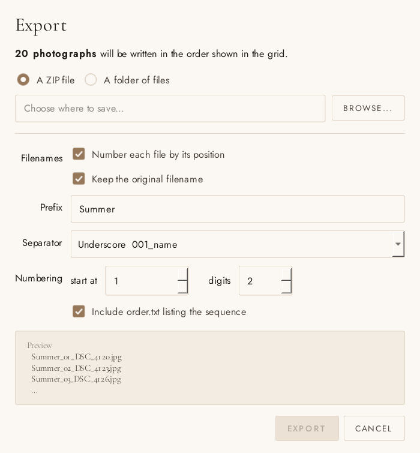

# Photo Sequencer

Photo Sequencer is a small Windows app for putting a set of photos in order and
exporting them in that order. You add your photos, drag them into the order you
want, and export them to a ZIP or a folder. Every exported file gets a number at
the start of its name, so the order stays the same in Explorer, on a phone, or
anywhere else that sorts files by name.



It is written in Python with PySide6 (Qt), Pillow and piexif. It does not
connect to the internet and it never changes your original files. Exporting
always writes copies.

## What it does

- Add photos by dragging them onto the window, or with Add photos and Add
  folder. Folders are searched all the way down, and a photo that is already in
  the list is not added twice.
- Drag a photo to move it. To move several at once, select them with Ctrl or
  Shift and drag any one of them. They keep the same order between themselves.
- Sort by filename, date taken or date modified to get a rough order, then
  adjust it by hand.
- Double click a photo to see it large. The arrow keys move through the set.
- Add a title, description, tags, photographer and copyright to many photos at
  once.
- Save the list to a .json file and open it again later. The file stores where
  each photo is, so don't move the originals in between.

## Metadata



Select the photos you want and press Metadata (or Ctrl+M). If nothing is
selected it applies to every photo in the list. Any box you leave empty keeps
what those photos already have.

In Title and Description you can use three placeholders:

| Placeholder | Replaced with                    |
| ----------- | -------------------------------- |
| `{n}`       | the photo's position in the list |
| `{total}`   | the number of photos in the list |
| `{name}`    | the original filename            |

For example, `Summer walks, {n} of {total}` gives "Summer walks, 1 of 20" on the
first photo and "Summer walks, 2 of 20" on the second.

Save as my details remembers what is in the Photographer, Copyright and Tags
boxes so you don't have to type them for every shoot, and Use my details puts
them back. They are kept in the Windows registry under
`HKCU\Software\Photo Sequencer`.

Metadata only goes into the exported copies, and only JPEG and WebP files can
hold it. Other formats still export, just without it. The new fields are added
to the file's existing EXIF data without saving the image again, so the quality
does not drop and the camera settings are kept. Windows shows these fields when
you right click a file and open Properties, then Details.

## Exporting



With the default settings and the prefix `Summer`, an export looks like this:

```
Summer_01_DSC_4120.jpg
Summer_02_DSC_4123.jpg
Summer_03_DSC_4126.jpg
...
order.txt
```

You can change the prefix, the separator, the starting number and how many
digits to use, or leave out the number or the original filename. The window
shows the first few names as you change the settings. If you turn numbering off
it warns you, because then the order is only recorded in order.txt, which lists
every photo in order next to its original filename.

If two files would end up with the same name, the second one gets (2) added to
the end so nothing is overwritten. If a photo was moved or deleted after you
added it, the export skips it and tells you which ones it skipped.

## Running it from source

You need Windows 10 or 11 and Python 3.10 or newer. It was developed on Python
3.13.

```
pip install -r requirements.txt
python app.py
```

You can also give it files or folders when you start it:
`python app.py "C:\Photos\Shoot"`

## Building the .exe

Run `build.cmd`. It installs what it needs, including PyInstaller, and creates
`dist\Photo Sequencer\Photo Sequencer.exe`. To give the program to someone, send
them the whole `Photo Sequencer` folder. They don't need to install anything.

The build makes a folder instead of a single .exe because a single file build
has to unpack about 60 MB every time it opens, which made it take over a minute
to start. The folder version opens in about a second.

The .exe is not signed, so the first time it runs Windows may say "Windows
protected your PC". Click More info, then Run anyway.

## File types

JPEG, PNG, WebP, TIFF, BMP, GIF, PPM and PGM. HEIC (the iPhone default) and
camera RAW files are not supported.

## Keyboard shortcuts

| Keys   | Action                          |
| ------ | ------------------------------- |
| Ctrl+O | Add photos                      |
| Ctrl+A | Select all                      |
| Delete | Remove the selected photos      |
| Ctrl+M | Metadata                        |
| Ctrl+E | Export                          |
| Ctrl+S | Save the list                   |
| Ctrl+L | Open a saved list               |
| Arrows | Previous and next photo in the large view |

## How the code works

Everything is in `app.py`.

The order of the photos is the order of the rows in the grid, which is a
QListWidget in icon mode. Nothing else keeps track of it.

The grid uses Qt's Static movement mode, because it is the only mode that
reliably lays the thumbnails out in the right order again after a move. That
mode turns dragging off, so the grid starts drags itself, works out where the
photo should land from the mouse position, and moves the rows in `apply_drop()`.

Thumbnails load in background threads, and only for the photos on screen plus a
screen above and below, so a folder of a thousand photos opens without a wait.
Each thumbnail is made once at 480 pixels and scaled for display, so moving the
size slider doesn't reload anything.

Exporting runs in its own thread. A ZIP is written to a temporary .part file and
only renamed when it is finished, so cancelling never leaves a broken ZIP
behind. Photos go into the ZIP without compression, because JPEGs are already
compressed and compressing them again takes much longer for almost no saving.

## Files

```
app.py             the app
make_icon.py       draws the icon and the checkbox and radio button images
build.cmd          builds the .exe
requirements.txt   Python packages
fonts/             Cormorant Garamond and Jost, with their licences
docs/              screenshots used in this README
```

The .png and .ico files in the main folder are made by make_icon.py.

## Credits

The fonts are Cormorant Garamond and Jost, both released under the SIL Open
Font License. The licence files are in the fonts folder. The photos in the
screenshots are crops of free CC0 panoramas from Poly Haven.
